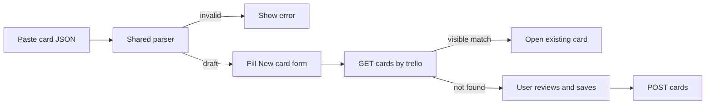

# Implementation Plan: Trello single-card JSON import

- **Date:** 2026-11-27
- **Status:** Draft
- **Scope:** `packages/shared` parser and the web New card dialog. No new HTTP route, MCP tool, or milestone step. Building waits until asked. The next unchecked implementation step remains M6.3 `[HUMAN]`.

## Goal

From a Trello card, use **Share → Export JSON**, paste that object into **New card**, and copy the relevant fields onto an agent-kanban card.

## Decisions

- **One card, not a board.** A real Export JSON is one card object: `name`, `desc`, `labels`, `due`, `url`, `shortUrl`, `shortLink`, `idList`, `actions`, `checklists`, `members`, plus fields the importer must ignore (`email`, `pluginData`, `cover`, `customFieldItems`). A board export is out of scope.
- **Paste fills the form, then the existing save creates the card.** No new HTTP route and no MCP tool. `POST /api/cards` already accepts `trelloUrl`, `trelloShortLink`, and `checklists`. `GET /api/cards/by-trello` already finds a visible card by URL or short link.
- **Fields copied:** title, description, tags, due date, Trello URL, short link, checklists, and status.
- **Current list name is on `actions`, not on the card root.** Keep the newest action whose `data.list.id` or `data.listAfter.id` equals `idList`, and read that object's `name`. Ignore `listBefore`. Compare the name case-insensitively after trim: `to-do`, `todo`, and `to do` → `todo`; `doing` and `in progress` → `doing`; `blocked`, `waiting`, and `on hold` → `blocked`; `done`, `complete`, and `completed` → `done`. Any other name, or no matching action, becomes `todo` and the dialog shows a warning with the list name when one was found.
- **People, comments, attachments, custom fields, covers, `closed`, `dueComplete`, `recurrenceRule`, and `pinned` are not copied.** A label such as a repeat marker becomes a tag only. It does not create a recurrence rule. Household sharing stays the existing New card toggle (default on). The importer does not assign Trello members.
- **Never persist or commit a real export.** A real export can contain an email address, a Trello username, a board name, and household card text. The parser drops `email`, `members`, and the rest of `actions` after the list lookup. Tests use a fictional card with the same shape. Fixture emails, if any, use `@example.test`.
- **A visible card with the same short link is not created again.** The paste action looks it up first and points at that card. A card the caller cannot see stays hidden (`404`), and a new card can still be created.
- **One human create emits the normal `card.created` event.** That is the existing create path, and it is the right behavior for a single card.

## Field mapping

Parser lives in `packages/shared` as a pure function. The web app passes either a JSON string or an already-parsed value.

- `name` → title. Trim. Empty is an error. Longer than 300 characters is an error naming the limit, so the title can be shortened before save.
- `desc` → description, markdown kept as text. Missing `desc` becomes `""`.
- `labels[].name` → tags through the existing `normalizeTags` (trim, lowercase, dedupe). Blank names (color-only labels) are dropped. A name longer than 50 characters is skipped and reported as a warning, and the rest of the card still imports.
- `due` → due. `null` or missing means no due date and `dueHasTime: false`. A timestamp sets `dueHasTime: true`. `dueFirm` stays `false`.
- `url`, otherwise `shortUrl`, → `trelloUrl` when it is an http(s) URL.
- `shortLink` → `trelloShortLink`. If it is missing, create already derives it from `trelloUrl`.
- Current list name → `status` through the alias table above.
- `checklists[]` → checklists. Use `name` as the title. Sort `checkItems` by `pos` ascending. `state: "complete"` → `checked: true`; anything else → `false`. Drop empty item names. Skip a checklist title longer than 200 characters or an item longer than 500 with a warning, and keep the rest. The dialog lists checklist titles and item counts. Save sends them on the existing create payload. Missing `checklists` becomes `[]`.
- Anything else is ignored, including `email`. If `name` is missing, or the value is not a JSON object, the result is a single readable error.

## Assumptions & Open Decisions

- Export JSON is the card object, not a board export and not a wrapper. If `name` is missing, the parser says so.
- Status is chosen by the list-name map, not by a control in the paste UI.
- Building these phases waits until asked. Do not insert them ahead of the open M6.3 `[HUMAN]` gate, and do not duplicate these phases into `docs/IMPLEMENTATION_PLAN.md`.

---

## Phases & Validation Gates

### Phase 1: Parser

**Changes:**

- [ ] Add `parseTrelloCardImport` in `packages/shared/src` and export it from the package entry.
- [ ] Cover a fictional card with the same shape as an Export JSON: emoji label, color-only label, missing description, overlong title, overlong tag, each list alias, an unknown list name, the newest matching action beating an older one, no matching list, checklist items sorted by `pos` with `complete` checked, an empty item dropped, an overlong item skipped, invalid JSON, a non-object payload, and an `email` field that does not appear in the result. Use `packages/shared/src/__tests__/schemas.test.ts` or a sibling test file. Do not copy a real export into the repo.

**Validation Gate 1:**

- Command / check: `pnpm --filter @agent-kanban/shared exec vitest run src/__tests__/schemas.test.ts` (or the new test file)
- Expected result: exit code `0`
- If it fails: inspect the parser result against the fictional fixture before changing card-create code.

---

### Phase 2: New card paste

**Changes:**

- [ ] In `apps/web/src/components/QuickAddModal.tsx`, add a paste area and an action that fills title, description, tags, due, `dueHasTime`, `trelloUrl`, `trelloShortLink`, status, and checklists. Do not submit the form from that action. The New card dialog has no status or checklist editor today, so show the chosen status as text and list checklist titles with item counts. Save sends both.
- [ ] Pass those fields through the existing `createCard` call in `apps/web/src/lib/api.ts`.
- [ ] On a successful parse with a short link or URL, call the existing by-trello lookup. A visible match replaces the create action with a link to that card. `404` continues to the normal save.
- [ ] Show parser errors and tag warnings on the dialog.

**Validation Gate 2:**

- Command / check: `pnpm --filter @agent-kanban/web exec tsc --noEmit`, then exercise the dialog in the browser.
- Expected result: typecheck exits `0`. A valid paste fills the form, shows the mapped status and checklist counts, and save creates a card whose Trello link, status, and checklist items match the paste. Invalid JSON shows the error and does not create a card. Pasting the same short link again opens the existing card.
- If it fails: confirm the paste action only fills state and that create still goes through `POST /api/cards`. Then check the by-trello request uses the parsed short link or URL.

---

### Phase 3: Documentation & Onboarding Update

**Changes:**

- [ ] `README.md` gets a short "Import a Trello card" note: where the JSON comes from, which fields copy, and how list names become status.
- [ ] Check off the phases in this file only after each gate passes. Leave the milestone checklist in `docs/IMPLEMENTATION_PLAN.md` unchanged.
- [ ] Record any troubleshooting lessons discovered during execution.
- [ ] Set **Status** at the top of this file to `Complete`.

**Validation Gate 3:**

- Command / check: `pnpm lint && pnpm -r typecheck && pnpm hygiene:check`, plus the Phase 1 test.
- Expected result: every command exits `0`, and this file no longer says the idea is undefined.
